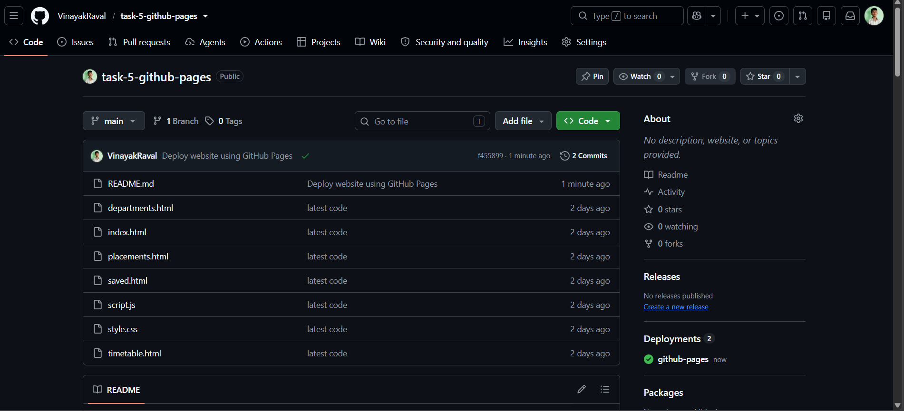
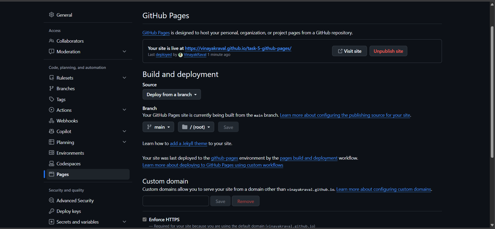
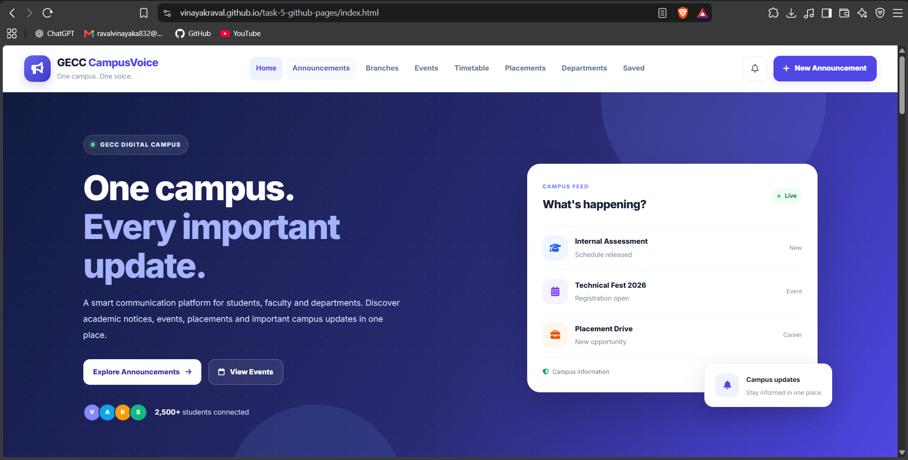

# Task 6: Host a Static Website with GitHub Pages

## Objective
Deploy a static website for free using GitHub Pages and document the deployment process with screenshots.

## Project
- **Project name:** Campus-Voice
- **Frontend:** HTML, CSS, and JavaScript *(update this if your project uses React/Vite)*
- **Hosting:** GitHub Pages
- **Backend:** GitHub Pages does not run a traditional backend server. If this project requires backend APIs, deploy the backend separately and connect the frontend to its public API URL.
- **Database:** Configure separately if required by the application.

## What I Did
1. Created or prepared the website files, including `index.html`.
2. Initialized Git in the project folder.
3. Staged the project files using `git add .`.
4. Checked the repository status and branch.
5. Configured the GitHub remote repository.
6. Committed and pushed the code to GitHub.
7. Opened **Repository → Settings → Pages**.
8. Selected **Deploy from a branch**, branch `main`, and folder `/ (root)`, then saved.
9. Waited for GitHub Pages to publish the website.
10. Opened the published URL and checked that the website loaded.

> Keep only the steps you have actually completed. If deployment is not finished yet, describe the remaining steps as pending.

## Deployment Architecture

```text
Visitor's Browser
       |
       v
GitHub Pages (Static Frontend)
       |
       | HTTPS API requests, if needed
       v
Separately Hosted Backend (e.g. Render)
       |
       v
Hosted Database (if required)
```

GitHub Pages serves static website files. It does not host a traditional always-running Node.js, PHP, or Python backend.

## Screenshots

Save your own screenshots in a folder named `screenshots/` in this repository. Use the filenames below, then replace each placeholder with the corresponding Markdown image reference.

### 1. Project Files


*Capture the project folder showing the website files.*

### 2. Git Repository Status


*Capture PowerShell showing `git status` and the current branch.*

### 3. GitHub Repository


*Capture your GitHub repository showing the uploaded project files.*

### 4. GitHub Pages Settings


*Capture Settings → Pages showing the selected deployment branch and folder.*

### 5. Deployment Successful


*Capture the Pages screen showing the published website URL or a successful deployment status.*

### 6. Live Website


*Capture the deployed website open in a browser.*

### 7. Backend Deployment (Optional)


*If the project has a backend, capture its hosting dashboard showing a successful deployment. Do not include secrets, API keys, passwords, or database credentials.*

## Git Commands Used

```powershell
git status
git branch
git remote -v
git add .
git commit -m "Deploy website using GitHub Pages"
git push -u origin main
```

If `git commit` reports `nothing to commit, working tree clean`, there are no uncommitted changes at that moment. Check `git remote -v` before pushing to ensure the repository URL is correct.

## Result
**Status:** Update this section after testing the deployment.

- [ ] Website files pushed to GitHub.
- [ ] GitHub Pages enabled for the `main` branch and `/ (root)`.
- [ ] Live website URL opens successfully.
- [ ] Screenshots added to the `screenshots/` folder.
- [ ] README updated with the correct repository and live website links.

**GitHub repository:** `https://github.com/VinayakRaval/task-5-github-pages.git`

**Live website:** `https://vinayakraval.github.io/task-5-github-pages/index.html`

Replace the example URLs above with your actual links.

## What I Learned
- How to track website files with Git.
- How to push project code to GitHub.
- How to configure GitHub Pages to publish a static website.
- How to document deployment evidence using screenshots.
- The difference between static frontend hosting and backend hosting.
